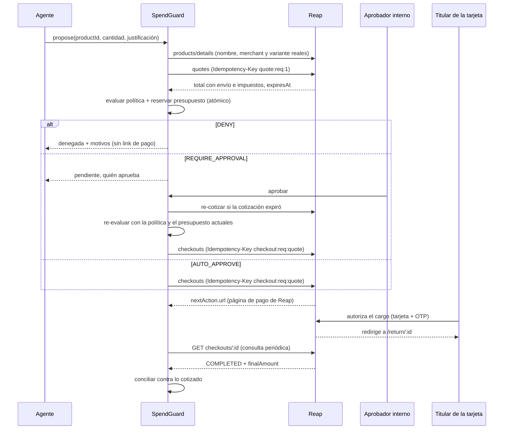
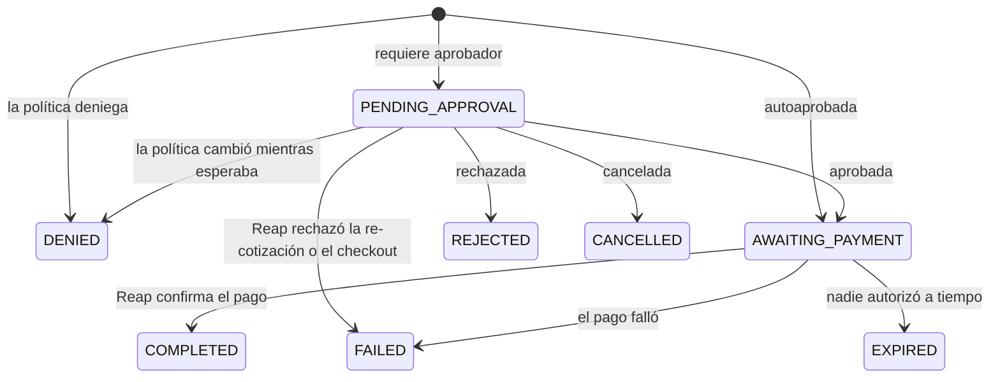

# Arquitectura de SpendGuard

## Idea central

Hay **dos aprobaciones**, y cada una contesta una pregunta distinta:

| Capa | Pregunta | Quién decide |
|---|---|---|
| SpendGuard (antes del pago) | ¿Debería existir este cargo? | El motor de políticas y, si hace falta, un aprobador interno autorizado |
| Reap (página de pago) | ¿Autorizo este cargo a mi tarjeta? | El titular de la tarjeta, en la página hospedada por Reap |

El link de pago de Reap **solo se crea** cuando la primera capa dijo que sí. El agente nunca paga ni ve datos de tarjeta.

---

## Flujo de una compra

Volver a `returnUrl` **no** significa que la orden existe: SpendGuard siempre confirma con `GET /agentic/checkouts/{id}`, tanto al regresar como en la conciliación periódica.

---

## Estados de una solicitud

---

## Componentes

| Archivo | Responsabilidad |
|---|---|
| `src/domain/policy-engine.ts` | Motor **puro y determinista**: recibe la compra, la política y el gasto del mes, y regresa la decisión con **todas** las reglas que se activaron. Gana la más estricta: DENY > REQUIRE_APPROVAL > AUTO_APPROVE. |
| `src/domain/ledger.ts` | El presupuesto **se deriva de la bitácora de solicitudes**, no de un saldo aparte que se pueda desfasar. Comprometido = COMPLETED al monto final. Reservado = PENDING_APPROVAL y AWAITING_PAYMENT al total cotizado. Lo demás no cuenta, así que el presupuesto se libera solo. |
| `src/domain/policy.ts` | Esquema de la política (zod), carga y reemplazo con versión. |
| `src/services/purchase-service.ts` | El único lugar donde se juntan política, presupuesto y Reap. |
| `src/reap/client.ts` | Cliente HTTP de Reap: autenticación, `Reap-Version`, idempotencia y reintentos. |
| `src/reap/mock.ts` | Reap simulado en memoria con el comportamiento que importa (expiración, idempotencia, envío, checkout hospedado, PROCESSING → COMPLETED). |
| `src/agent/` | Contrato para el agente y herramientas seguras. No incluye agente; ver [AGENT_INTEGRATION.md](AGENT_INTEGRATION.md). |
| `src/store/store.ts` | Interfaz `Store` + implementación en JSON con escritura atómica. |
| `src/app.ts`, `src/server.ts` | API REST, dashboard, página de pago simulada y conciliación periódica. |

---

## Reglas de la política

| Regla | Resultado |
|---|---|
| `UNKNOWN_DEPARTMENT` | DENY |
| `MERCHANT_BLOCKED` (dominio exacto o subdominio) | DENY |
| `MERCHANT_NOT_ALLOWLISTED` (si hay lista de permitidos) | DENY |
| `KEYWORD_BLOCKED` (nombre del producto o lo que pidió el usuario) | DENY |
| `QUANTITY_LIMIT` | DENY |
| `HARD_CAP` (tope por compra del departamento) | DENY |
| `JUSTIFICATION_REQUIRED` (arriba de cierto monto, mínimo 10 caracteres) | DENY |
| `CURRENCY_UNSUPPORTED` (sin tipo de cambio configurado) | DENY: sin tasa no se puede validar presupuesto ni tope |
| `BUDGET_EXCEEDED` | Configurable: DENY o REQUIRE_APPROVAL |
| `PRICE_DRIFT` (cotizado muy arriba de lo que dijo el usuario) | REQUIRE_APPROVAL |
| `APPROVAL_THRESHOLD` (arriba del límite de autoaprobación) | REQUIRE_APPROVAL |
| `WITHIN_AUTO_APPROVE_LIMIT` | AUTO_APPROVE |

Se juzga siempre en la moneda base de la política (USD por defecto, con tipos de cambio en `fx`).

---

## Garantías

1. **El agente no decide precio, merchant ni categoría.** SpendGuard vuelve a pedir el producto a Reap y resuelve la variante a partir del producto, así que un agente no puede combinar un producto permitido con la variante de uno bloqueado. El monto que se juzga es el de la cotización de Reap.
2. **Los agentes en paralelo no pueden gastar de más.** "Leer gasto, evaluar y reservar" corre dentro de un mutex. Dos compras simultáneas por el último presupuesto: una pasa y la otra se deniega (hay prueba).
3. **Sin link de pago antes de la decisión.** El checkout de Reap se crea solo después de AUTO_APPROVE o de una aprobación humana autorizada.
4. **Separación de funciones.** Solo los aprobadores del departamento aprueban, y nadie puede aprobar su propia solicitud (salvo que la política lo permita).
5. **Re-validación al aprobar.** Si la cotización expiró se vuelve a cotizar. Si el precio subió más que la tolerancia, la aprobación se detiene y hay que volver a aprobar viendo el precio nuevo. La política se vuelve a evaluar con el presupuesto actual.
6. **Nunca dos checkouts por la misma compra.** Las llaves de idempotencia son deterministas: `quote:{solicitud}:{intento}` y `checkout:{solicitud}:{cotización}`. Reintentar, o recuperarse de una caída, repite la misma llamada en lugar de crear otra.
7. **Conciliación.** Al completarse, el cargo final se compara con lo cotizado. Si la diferencia pasa de `max(0.01, cotizado × reconciliationTolerancePct)`, queda marcada para revisión con un evento `RECONCILIATION_VARIANCE`.
8. **Auditoría completa.** Cada paso queda en la bitácora con quién lo hizo: solicitud, cotización, evaluación, aprobación, checkout, cambios de estado, conciliación y cambios de política.
9. **Reintentos seguros de los agentes.** Con `clientRef`, proponer dos veces la misma compra del mismo solicitante regresa la primera solicitud.

### Manejo de errores de Reap

Reap guarda en caché las respuestas 4xx y 5xx por `Idempotency-Key` durante 24 h, así que repetir la misma llave después de un 5xx solo repite el error.

| Llamada | Ante 5xx | Ante red caída o 429 |
|---|---|---|
| Lecturas y búsquedas | Reintenta igual | Reintenta con backoff (Retry-After con tope de 30 s) |
| Crear cotización | Reintenta con una llave derivada (`…:r1`) | Reintenta |
| Crear checkout | **No reintenta**: un cargo duplicado es peor que un error. La solicitud pasa a FAILED y se libera el presupuesto. | Reintenta con la misma llave (es seguro). Si se agota, la solicitud sigue pendiente para reintentar. |

---

## Decisiones y límites conocidos

- **Autenticación del dashboard:** en la demo, quien actúa se identifica por correo ("Actuando como"). En producción va detrás de SSO o de autenticación real.
- **Un solo proceso:** el mutex funciona dentro de un proceso. Con varias instancias se cambia por una transacción o un candado en base de datos (la interfaz `Store` ya lo permite).
- **Persistencia:** archivo JSON con escritura atómica; suficiente para la demo. Se puede cambiar por SQLite o Postgres implementando `Store`.
- **Mes del presupuesto:** la compra cuenta en el mes (UTC) en que se solicitó, aunque se pague al mes siguiente.
- **Solicitudes pendientes viejas:** siguen reservando presupuesto hasta que alguien las apruebe, rechace o cancele. Siguiente paso: que expiren solas.
- **Sin webhooks:** Reap no empuja eventos en esta versión, así que SpendGuard consulta los checkouts abiertos cada `POLL_INTERVAL_MS`.
- **Compras recurrentes y mandatos:** no están disponibles en el Agentic module de Reap, así que no se modelan.

### Pendientes por validar en live

La integración live sigue la documentación de Reap, pero no se ha probado contra el sandbox real. Al recibir las keys, revisar:

- **Región de la key:** México (`mx.sandbox…`) o Singapur (`sg.sandbox…`).
- **`owner` del checkout:** la documentación muestra `owner.reference` en un lugar y `owner.id` en otro. SpendGuard manda `{ type: 'CLIENT_REFERENCE', reference, email }`. Si Reap lo rechaza, el cambio es una línea en `openCheckout` de `purchase-service.ts`.
- **Habilitación:** el módulo puede regresar `403 AGENTIC_PAYMENTS_NOT_ENABLED` hasta que Reap lo active.
- **Forma exacta de las respuestas:** `shippingOptions`, `amountBreakdown`, `nextAction` y `finalAmount`; ajustar los tipos en `src/reap/types.ts` si algo difiere.
- **Dirección de envío:** cada tienda debe enviar a la dirección de las variables `SHIP_*`.
- **Enrollment:** hoy no se manda `enrollmentId`, así que el titular captura la tarjeta en la página de Reap. Con una tarjeta ya registrada se puede pasar su `enrollmentId`.

---

## Siguientes pasos

1. Conectar las keys del sandbox y validar los puntos de la lista anterior.
2. Conectar el agente de compras ([AGENT_INTEGRATION.md](AGENT_INTEGRATION.md)).
3. Autenticación real y roles para el dashboard.
4. Expiración automática de solicitudes pendientes.
5. **Opcional, para la categoría onchain:** usar Kwal de Payward (skill para Claude Code y Codex, tarjeta respaldada por la wallet del usuario, Ink Sepolia). Las reglas de SpendGuard podrían vivir en un contrato inteligente que defina cuándo y cuánto puede pagar el agente, y la identidad onchain podría probar a nombre de quién actúa. No está construido.
